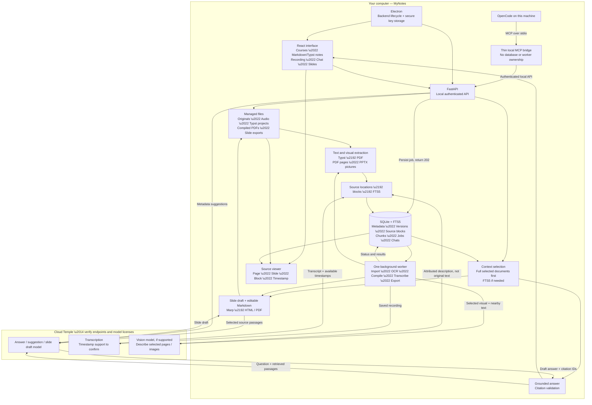

# MyNotes — Proposed Architecture

## 1. Decisions confirmed — KISS

- **Single-user desktop app:** Electron + React/TypeScript + Python/FastAPI + SQLite.
- **Direct context first** for explicitly selected documents that fit the model context window, with verifiable citations. **SQLite FTS5** for lexical search and for selecting passages when context becomes too large.
- **No embeddings in this version.** The README will document observable search limits and possible evolutions, without installing semantic dependencies.
- **Edit notes in Markdown or Typst.** Import PDF, PPTX, HTML, and Typst projects.
- **Record the microphone inside the application** via Chromium's `getUserMedia` / `MediaRecorder` APIs.
- **Add a Slides tab:** generate a draft from selected course material, edit it, preview it, and export HTML and vector-preserving PDF. Expose the same capabilities as **MCP tools usable by OpenCode** on each machine.
- **Use open-source application tools.** Cloud Temple is explicitly allowed as a commercial hosted AI service; verify the licenses and capabilities of selected models separately.

KISS means one application, one Python backend, one SQLite database, and one background worker. No external search server, message broker, or vector database. Use **uv exclusively for all Python dependency management and execution**, with `pyproject.toml` and a committed `uv.lock`.

## 2. Electron as delivery format

Electron is the selected delivery format. It provides a standalone window, native file selection, and browser microphone recording without separately starting a server.

A container would run the backend while the host browser handles microphone permissions. It would simplify backend distribution but require a container runtime; on Windows/macOS/Linux containers typically run through a VM. Electron requires packaging for each target OS, but the backend and React interface remain ordinary web components, making a container deployment possible later without building it now.

## 3. Tools: definition, purpose, and example

All chosen application tools are open-source. Pin versions and verify their license files when implementing.

| Tool | Definition and why it is used | Example |
|---|---|---|
| **Electron** (MIT) | Desktop shell using Chromium and Node.js. Runs the UI and manages the local Python process. | Open MyNotes as an installed application. |
| **React** (MIT) | UI library for composing interactive screens. | Course list, note editor, chat, and Slides tab. |
| **TypeScript** (Apache-2.0) | JavaScript with static type checking. | Define a citation object with a document version and page. |
| **Vite** (MIT) | Frontend development server and production build tool. | Build React into assets bundled with the desktop app. |
| **Python** (PSF license) | Backend language with document-processing libraries. | Extract text from a lecture PDF. |
| **uv** (MIT / Apache-2.0) | Python dependency, environment, and execution manager. Replaces pip-based workflows. | `uv add fastapi`, `uv sync --locked`, `uv run python -m mynotes`. |
| **FastAPI** (MIT) | Python HTTP API framework. | `POST /imports` accepts a file and returns a job ID. |
| **Pydantic** (MIT) | Validates structured request and response data. | Reject a malformed slide-generation request. |
| **SQLite + FTS5** (public domain) | Embedded database and full-text search extension. Python's `sqlite3` accesses it without another server. | Search "Bayes" within one course and rank matching excerpts. |
| **pypdfium2 / PDFium** (Apache-2.0 / BSD-style) | PDF text extraction and page rendering. Use one PDF engine for text and visual snapshots. | Extract page 12 and render it as a PNG for OCR or a vision model. |
| **PDF.js** (Apache-2.0) | Browser PDF renderer. | Open a citation directly on page 12. |
| **python-pptx** (MIT) | Reads and writes PowerPoint `.pptx` files. | Extract slide 7 and show its text as a citation target. |
| **Beautiful Soup** (MIT) | HTML parser for extracting headings and text. | Read an exported course webpage without executing its scripts. |
| **Typst CLI** (Apache-2.0) | Compiler for the Typst document language. | Compile `lecture.typ` and its assets into a PDF preview. |
| **Tesseract** (Apache-2.0) | Local OCR that recognizes printed text in images; does not understand diagram relationships. | Read French/English text from a scanned PDF page and index it with its page number. |
| **MCP Python SDK** (MIT) | Implements Model Context Protocol so AI clients can discover and call application tools. | OpenCode submits Marp Markdown and requests PDF export through a local stdio bridge. |
| **Marp CLI** (MIT) | Converts Markdown slide decks into presentations. | Export one edited deck to both `.html` and `.pdf`. |
| **Chromium** (BSD-style) | Open-source browser engine used by Electron and by Marp's PDF export. | Print slide text and SVG graphics to PDF without screenshotting whole slides. |
| **HTTPX** (BSD-3-Clause) | Python HTTP client for provider API calls. | Send retrieved excerpts to Cloud Temple's answer endpoint. |
| **cryptography / Fernet** (Apache-2.0 / BSD-3-Clause) | Authenticated encryption for saved API credentials. | Save an encrypted Cloud Temple API key outside the repository. |
| **Electron safeStorage** (part of Electron) | OS-backed protection for small secrets. | Protect the credential-encryption key when a secure OS backend is available. |
| **Electron Forge** (MIT) | Builds and packages Electron applications. | Produce a platform-specific application installer. |
| **PyInstaller** (GPL with distribution exception) | Bundles Python and its dependencies into a runnable backend. | Start the backend on a machine without a development Python installation. |

Microphone capture uses the standard **`getUserMedia`** and **`MediaRecorder`** APIs supplied by Chromium. Example: request microphone permission, record locally, stop, and submit transcription work.

**No semantic dependencies in the initial application:** no embedding model, NumPy vector scoring, vector storage, or OpenSearch. The README may describe them as possible responses to measured search limits.

Python development/build commands use `uv add`, `uv lock`, `uv sync --locked`, and `uv run`. `uv.lock` is committed; secrets and application data are not. PyInstaller builds run through uv; the packaged end-user app does not require uv or Python to be installed. The development MCP bridge also runs through uv, with a packaged bridge command provided for installed releases.

## 4. Architecture graph



The worker, retrieval, extraction, and slide modules belong to the same backend. AI responses are drafts; the backend resolves source references and the user can edit organization and slides.

## 5. Small-data chat and lexical search \u2014 no embeddings

**By default, use the full content of explicitly selected documents**, as they should fit within the model's context window. Source IDs (blocks, pages, slides) must still be preserved for citation.

Initial flow:

1. Choose documents, course, or chapter. Estimate input size against the model's context limit, reserving room for instructions, chat history, images if present, and the answer.
2. If the selected material fits, send its **full extracted text** with backend-assigned source IDs. Include only selected or relevant visuals\u2014a PDF's small file size does not imply a small multimodal token budget.
3. If it exceeds the budget, signal that passage selection is being used; search FTS5 within the same scope and send a bounded set of matching passages. **Never silently truncate a document and imply it was fully read.**
4. Ask the model to answer from the supplied material and report insufficient evidence where appropriate.
5. Validate citation references, resolve source locations, and display answer plus excerpts.

This is **grounded document chat**; the fallback retrieval path is lexical RAG. Neither path needs embeddings. FTS5 also powers ordinary library search independently of chat.

### README: search limits and possible next steps

Document the current design and how to evaluate it:

- Direct context is simplest for a few selected courses/documents, but larger selections increase latency and provider usage.
- FTS5 finds words and expressions; it can miss synonyms. Example: "memorizing training examples" may miss a passage written only as "overfitting."
- Keep roughly ten real questions with known relevant passages as a small evaluation set. Measure missed evidence, not just answer fluency.
- **Only if demonstrated lexical limits warrant it**, consider a semantic search experiment: an embedding model produces numerical representations of passages/questions, and cosine similarity compares them. There is **no implementation or embedding dependency in the current scope**.
- A future hybrid experiment can combine lexical and semantic rankings by reciprocal rank fusion. Reranking or a separate search engine would require their own measured justification.

### What a checker adds

Initial deterministic checks ensure citations refer to supplied evidence and resolvable material versions. Flag uncited claims and missing sources. These checks do not prove that a statement follows from its citation.

An optional later model-based checker can compare claims with cited passages and flag unsupported claims, but it adds cost and can itself be wrong. Introduce it only if evaluated answers show a recurring grounding problem. Course material is evidence, not executable instructions.

## 6. Notes, imports, and exact sources

- **Notes:** choose Markdown or Typst per note. Save editable source; preview Markdown as safe rendered text and Typst as a compiled PDF. No full IDE or rich-text framework initially.
- **Organization:** course, chapter, class date, import date, and editable AI suggestions. Allow unassigned material instead of forcing guessed metadata.
- **Provenance:** app document ID + immutable version ID + location. Preserve originals before processing and store cited excerpts with chat history.
- **PDF/Typst:** cite compiled page plus excerpt. Typst imports accept a standalone file or project folder with imports/assets and an entry point; preserve the project and show compilation errors. PDF citations do not imply Typst source-line mapping.
- **PPTX:** cite slide number and extracted text. A full-fidelity PowerPoint viewer is outside the first version; show extracted slide content and offer the original file.
- **HTML/Markdown:** cite a saved section/block and text range. Display extracted or sanitized content without executing imported scripts.
- **Audio:** save recording segments locally during capture; transcribe after stopping. Cite real segment start/end times when supplied by the service. If timestamp support is absent, keep transcript citations but do not claim exact audio positions; choose a timestamp-capable service before promising that feature.

Extract locations before splitting long text into blocks, and retain them when reducing context. Reimporting creates a new version so old citations remain valid.

### Images inside PDF and PPTX

Use three distinct layers; none substitutes for the others:

| Layer | What it provides | Source locator |
|---|---|---|
| **Preservation / preview** | Keep the original document and a viewable page, slide, or extracted picture. | Immutable document version + page/slide; shape position if available. |
| **OCR** | Read printed text in an image with local Tesseract, then make that text searchable. | Original page/slide or picture, with OCR word boxes when available. |
| **Visual interpretation** | A verified vision-capable model can describe a diagram, chart, or formula in context. | Original visual plus a separately marked generated description. |

**PDF pipeline:** extract existing text with pypdfium2. Render low-text/scanned pages for OCR; render other pages **on demand** when the user asks about a visual. A whole-page render includes vector diagrams, overlapping objects, and labels that embedded-image extraction alone would miss. Keep PDF.js for the original vector-preserving view. Rendered PNGs are analysis derivatives, not replacements for the PDF.

**PPTX pipeline:** python-pptx extracts text, tables where accessible, embedded pictures via the picture image bytes, and their slide/shape coordinates. Traverse grouped shapes where applicable. Save pictures with slide provenance and OCR them when useful. This does not render composite charts, SmartArt, or the full slide layout.

For a **complete visual slide**, accept the original author's PDF export. Alternatively, if open-source LibreOffice is installed, allow explicit headless PPTX-to-PDF conversion and reuse the PDF pipeline. LibreOffice is a cross-platform office suite, not a Python renderer; fonts/layout may differ from PowerPoint. Do not bundle its large runtime into the first installer merely to extract pictures. Clearly show when a slide's visual content has not been fully processed.

**Vision processing is on demand**, not an automatic paid call for every image. Example: "Explique le schéma de la page 8" sends that page image and nearby text to a confirmed Cloud Temple vision endpoint. If that capability is unavailable, preserve/show the image and explain the extraction limit; do not pretend OCR understood the arrows or chart.

Store extracted text, OCR text, and model-generated visual descriptions separately. Model descriptions may aid lexical retrieval but remain derived, potentially erroneous material; cite the actual image and expose the description's origin. For slides generated from course material, reuse selected saved pictures when appropriate and preserve their source citations.

## 7. Slides tab \u2014 HTML and vector-preserving PDF

1. Select source documents or a course chapter, topic, desired slide count, and language.
2. Use the explicitly selected material directly when it fits the context budget; otherwise select passages lexically. Include chosen saved visuals with their source references.
3. Ask Cloud Temple for a structured slide draft with source references. Convert it to controlled Marp Markdown rather than executing model-generated HTML or JavaScript.
4. Show editable Markdown and slide preview; resolve source references into human-readable citations and excerpt links.
5. Run Marp CLI in a background job to export **HTML and PDF**. Save editable Markdown, exports, and the source-version references.

**Vector-preserving PDF** means selectable text and vector shapes/SVG where Chromium's print engine preserves them. Do not export slides as full-page screenshots. PNG/JPEG images remain raster; arbitrary images cannot be promised as vector content. Use supported SVG math rendering where practical and verify a representative formula in the exported PDF.

HTML export should include required local assets so it remains usable offline. External export citations include source titles, pages/slides/timestamps, and excerpts or a source manifest; app-only links alone would not be useful outside MyNotes.

Marp is a single Markdown-to-HTML/PDF tool, avoiding a custom presentation framework. It is called by Python as a bounded subprocess with controlled file paths. Package its Node dependencies and a compatible headless Chromium; sharing Electron's browser executable is not assumed.

### OpenCode / AI tool access via MCP

Provide a **thin local stdio MCP bridge** using the official Python MCP SDK. It forwards calls to the same authenticated FastAPI endpoints as the Slides tab; it neither opens the database nor starts another worker. Electron must be running; an unavailable app produces a clear tool error.

Minimal tool surface:

| Tool | Purpose | Example |
|---|---|---|
| `get_material` | Read explicitly selected source text, citation IDs, and available visual references within a bounded response. | OpenCode reads the selected chapter before drafting slides. |
| `get_deck` | Read an existing deck and its revision. | Inspect a draft before changing it. |
| `save_deck` | Create or replace a deck's Markdown with valid source references; use an expected revision for updates. | OpenCode supplies its own Marp Markdown rather than asking Cloud Temple to write another draft. |
| `export_deck` | Queue HTML/PDF export and return a job ID. | Export the saved revision to both formats. |
| `get_job` | Get status and completed artifact references. | Poll the job and retrieve paths/download references to the exports. |

The calling AI can write content itself; **MCP save/export does not force a second model call**. Existing backend validation, source handling, jobs, and Marp export are reused. Deck revision checks prevent the AI from overwriting a user's concurrent edits.

Discover the app's ephemeral port and a separate tool-scoped session token from a restricted per-user runtime file outside Git. Limit this token to material reading and deck/job operations; it cannot read stored provider credentials or delete the library. Rotate it on restart and remove the discovery file on shutdown. This transient token is distinct from persistent Cloud Temple credentials, which remain encrypted. Read current discovery details per request to tolerate app restarts. Use OS file permissions/ACLs and redact tokens from logs.

Document a per-machine OpenCode MCP configuration using the installed bridge executable, or `uv run --project <absolute-project-path> --locked ...` for development. The configuration contains only the launch command, not API credentials or tokens. Validate the configuration against OpenCode's published schema and instruct the user to restart OpenCode after adding it. Remote cross-machine exposure is outside this local tool interface; install/configure it on each machine that runs MyNotes.

## 8. Long tasks: 202 Accepted and polling

Use the asynchronous HTTP pattern, with **SQLite as the persistent queue** for one user:

```text
POST /imports or /slide-exports
\u2192 persist queued job
\u2192 202 Accepted { job_id, status_url }

Background worker
\u2192 queued \u2192 running \u2192 succeeded / failed

GET /jobs/{job_id}
\u2192 state, progress, error or result references
```

The UI polls status while work continues. Imports, transcription, Typst compilation, and slide generation/export use jobs. Short operations remain ordinary requests; chat can stream responses.

`202` is returned only after saving the job. A worker loop handles persisted jobs outside request execution. On restart, interrupted work is recovered for bounded retry; idempotent indexing and staged exports prevent duplicate chunks or half-written final files. Timeouts and visible retry handle provider or compiler failures.

**RabbitMQ/Kafka are not required:** they add infrastructure without solving a current single-user problem. A broker becomes relevant if workers move to several processes/machines or throughput demands it.

## 9. Lifecycle, credentials, and storage

- Electron launches the bundled backend on `127.0.0.1` with an available port and random per-launch API token, waits for readiness, and terminates it on exit.
- Renderer Node access is disabled; context isolation is enabled. Only the trusted application can access the limited desktop bridge or microphone permissions.
- Credentials are **encrypted at rest, excluded from Git, absent from frontend bundles, and redacted from logs**. Provider calls happen in Python.
- Save the encrypted API credential in the app data directory using Fernet. Protect its encryption key with Electron's secure OS-backed `safeStorage`; deliver the key to Python over a private startup pipe, not a command-line argument.
- Verify that the OS provides a secure storage backend. Linux's insecure `basic_text` fallback is not accepted as encrypted persistent storage. If no secure backend exists, support session-only credentials until a secure store is configured.
- Store data outside the repository. `.gitignore` excludes local credentials, data, recordings, and generated output; examples contain placeholders only. Never place the decryption key next to ciphertext in plaintext.
- Backup/export includes a consistent database snapshot plus referenced original/derived files. API credentials are excluded by default and can be re-entered after restore.

## 10. Delivery and meaningful checks

### Phase 1 \u2014 desktop library

uv-managed Electron/React/FastAPI development and build, SQLite, course organization, **Markdown and Typst notes**, PDF/Typst import, lexical search, source viewing, persistent jobs, and README search roadmap.

**Check** a known PDF and multi-file Typst project: phrase search finds the right page; restart preserves data; compilation errors are visible.

### Phase 2 \u2014 grounded chat

Cloud Temple integration, encrypted credentials, **direct-context document chat with lexical RAG fallback**, editable metadata suggestions, and versioned citations. No embeddings.

**Check** real questions for retrieval relevance, course filtering, unsupported answers, invalid citation rejection, old citations after reimport, interrupted jobs, and secret exclusion.

### Phase 3 \u2014 capture and remaining imports

Microphone recording, timestamp-capable transcription, PPTX/HTML, PDF page rendering/OCR, preserved PPTX pictures, and on-demand visual interpretation where supported.

**Check** a scanned PDF, a PDF with vector diagrams, and a PPTX with pictures plus an unsupported composite chart. Verify provenance, OCR text, visible extraction limits, denied microphone permission, saved recordings, provider failure/retry, and playback at an actual supplied timestamp.

### Phase 4 \u2014 Slides tab and packaging

Grounded slide drafts, editable Marp Markdown, preview, HTML/PDF export, **OpenCode MCP tools**, installer, and backup/restore.

**Check** that OpenCode can read selected source material, save its own deck without a model call, export HTML/PDF, and poll results. Verify revision conflicts, app-closed errors, citations in exported slides, offline HTML assets, selectable PDF text and representative SVG content, and installation without development Python/Node dependencies.

## 12. Electron shell (Phase 1 — implementation plan)

### 12.1 Goal

Electron is the delivery format (PLAN §2). This plan covers the four files that form the Electron shell and its tests. Everything else (renderer, packaging) is out of scope.

**Files:** `electron/main.cjs`, `electron/preload.cjs`, `electron/security.cjs`, `tests/electron.test.cjs`

### 12.2 File-by-file spec

#### electron/main.cjs — Backend lifecycle, startup, BrowserWindow

**Responsibilities:**
1. **Launch backend:** Determine mode (dev vs packaged).
   - Dev: `uv run --locked python -m mynotes serve --port0 --data-dir <userData>` with `cwd` = project root (resolving `__dirname/..`).
   - Packaged: `resources/app-backend/mynotes` (executable — no Python/uv needed).
2. **Generate secrets:** On startup, generate `token` (app), `tool_token` (distinct), and optionally `fernet_key` via `crypto.randomBytes(32)`.
3. **Stdin JSON:** Write `JSON.stringify({token, tool_token, fernet_key})` to backend stdin, then close the write end.
4. **stdout readiness:** Parse backend stdout for `{url, token}` JSON. Wait for it (up to 30s, reject with error).
5. **Health readiness:** Poll `GET <url>/api/v1/health` (or `GET <url>/health?token=<token>`) with the app token until 200 OK (up to 30s, 500ms interval). Only then proceed.
6. **BrowserWindow:** Create with `contextIsolation: true`, `nodeIntegration: false`, `sandbox: true`, `preload: path.join(__dirname, 'preload.cjs')`. Load `file://...` to the Vite-built renderer or dev server URL.
7. **Terminate backend on exit:** On `before-quit` / `window-all-closed`, kill the backend process. `spawn` with `{stdio: ['pipe', 'pipe', 'inherit']}` and `child.kill()` on exit. No leaked processes.
8. **Packaged marp/chromium env:** Set `process.env.MYNOTES_MARP` and `process.env.MYNOTES_CHROMIUM` pointing to `resources/marp` and `resources/chromium` respectively (or `''` in dev).
9. **Fernet key validation:** If `fernet_key` is provided, validate it as base64url, 44 chars (Fernet 32-byte key base64-encoded). Reject startup with error if invalid.

**Stdout protocol:** Backend writes exactly one line of JSON to stdout on readiness: `{"url":"http://127.0.0.1:PORT","token":"<tool_token>"}`. Main reads this line, then proceeds to health polling.

**Stdin protocol:** Main writes exactly one JSON object to backend stdin (line-based or raw), then closes write. Backend reads it to get tokens and optional fernet_key.

#### electron/preload.cjs — Renderer IPC bridge

**Responsibilities:**
1. Expose `window.mynotes` as a namespace object with the following API:
   - `connection(): Promise<{url: string, token: string}>` — resolves when main sends `ready` IPC with `{url, token}`. Rejects if `connection-failed`.
   - `importFile(): Promise<{name: string, data: ArrayBuffer, kind?: string, entrypoint?: string}>` — opens native file chooser via IPC. If called as "import project", also offer ZIP. Returns file metadata + data.
   - `importProject(): Promise<{name: string, data: ArrayBuffer, kind?: string, entrypoint?: string}>` — alias for importFile with ZIP filter, or unified `showOpenFilePicker` with directory select.
   - `recordChunk(sessionId: string, audioData: Blob): Promise<{sessionId: string, sequenceIndex: number}>` — persists audio chunk locally in `userData/recordings/<sessionId>/<sequenceIndex>.wav`. Validates sessionId as UUID, sequenceIndex <= 100000.
   - `recordFinish(sessionId: string): Promise<{name: string, data: ArrayBuffer}>` — merges local chunks for session into single audio file, returns as ArrayBuffer. Chunks remain on disk until successful submit. Backup exclusion: recordings are in `userData/` which is already `.gitignore`d.
   - `on(event: string, handler: Function): void` — subscribe to IPC events from main.
   - `off(event: string, handler: Function): void` — unsubscribe.

2. **IPC validation (sender trust):** All IPC handlers validate that the sender is the trusted main window. In preload, `ipcRenderer` only sends; main validates origins.

3. **No direct Node access:** `contextBridge` exposes only these methods. No `require`, no `process`, no `window.require`.

#### electron/security.cjs — Security utility module

**Responsibilities:**
1. **safeStorage check:** `checkSafeStorage(): Promise<{secure: boolean, backend: string}>` — uses `require('electron').safeStorage.getEncryptionAvailable()` (and optionally `safeStorage.getSafeStorageBackend()` if available in Electron ≥28). On Linux, explicitly check that `getSafeStorageBackend() !== 'basic_text'`.
2. **pathSanitize:** `pathSanitize(p: string): string | null` — given a user-supplied path, returns `null` if it escapes the data directory or contains `..` traversal. Otherwise returns the resolved, safe path.
3. **token validation:** `validateFernetKey(key: string): boolean` — checks key is 44-char base64url (Fernet 32-byte key format). Returns `true`/`false`.
4. **origin match:** `originMatches(origin: string, expected: string): boolean` — exact string match. Used by main to validate IPC sender origins.
5. **Test helper:** `getElectronSecureFallback(): string` — returns `'basic_text'` when running without Electron (e.g., in tests), allowing test coverage without a real OS crypto backend.

#### tests/electron.test.cjs — Tests for security, preload IPC, main lifecycle

**Using Node's built-in `node:test` (no package.json ownership).**

**Test groups:**
1. **Security module:**
   - `test 'validateFernetKey accepts valid key'` — 44-char base64url
   - `test 'validateFernetKey rejects invalid key'` — wrong length, non-base64url chars
   - `test 'pathSanitize blocks .. traversal'`
   - `test 'pathSanitize allows safe relative path'`
   - `test 'originMatches exact match'`
   - `test 'originMatches rejects mismatch'`
   - `test 'getElectronSecureFallback returns basic_text'`
2. **SafeStorage check (node:module fallback):**
   - When `require('electron')` is not available, `checkSafeStorage` should gracefully return `{secure: false, backend: 'none'}` — test the fallback path.
3. **Preload IPC interface (interface-only):**
   - Verify preload exports are callable (mocked `contextBridge`).
4. **Main lifecycle (conceptual):**
   - Document expected flow: generate tokens → spawn backend → read readiness → health check → create window. Test structure is there for integration when backend's serve command exists.

### 12.3 Data flow

```
┌─────────────────────────────────────┐
│           electron/main.cjs         │
│  1. Generate token, tool_token      │
│  2. Generate optional fernet_key    │
│  3. Spawn backend (uv dev or pkg)   │
│  4. Write {token,tool_token,key}    │
│  5. Read stdout readiness JSON      │
│  6. Poll /health until 200          │
│  7. Create BrowserWindow            │
│  8. Send {url,token} to renderer    │
│  9. On exit → kill backend          │
└──────────┬──────────────────────────┘
           │  IPC (ipcMain/ipcRenderer)
           ▼
┌─────────────────────────────────────┐
│       electron/preload.cjs          │
│  - connection() → Promise<url,tok>  │
│  - importFile() → IPC → main        │
│  - recordChunk(sessionId, blob)     │
│  - recordFinish(sessionId)          │
│  - on/off event listeners           │
└──────────┬──────────────────────────┘
           │  FileSystem (userData dir)
           ▼
  userData/
  ├── recordings/<sessionId>/<seq>.wav
  └── (everything .gitignore'd)
```

### 12.4 Backend serve command (minimal, in main.cjs context)

Main.cjs expects the backend to support:
```
uv run --locked python -m mynotes serve --port0 --data-dir <path>
```

The `serve` subcommand must:
1. Read stdin for JSON `{token, tool_token, fernet_key}`
2. Generate a random port (when `--port0` is given)
3. Start FastAPI on `127.0.0.1:<port>`
4. Write `{url: "http://127.0.0.1:<port>", token: "<tool_token>"}` to stdout
5. Optionally use `fernet_key` to initialize `CredentialStore`

### 12.5 Security principles

- **contextIsolation + nodeIntegration:false + sandbox:true** — renderer is isolated from Node.
- **Preload is the only bridge** — renderer accesses desktop features only through exposed preload functions.
- **Origin validation** — main validates sender origin on every IPC.
- **Path sanitization** — any user-supplied path goes through `pathSanitize` before filesystem access.
- **safeStorage on Linux** — `basic_text` is rejected for persistent key storage. Without secure backend, session-only (in-memory) mode is used.
- **No external URLs** — navigation restricted to local file or trusted localhost. `open-external` only allows `https://`.
- **getUserMedia** — only requested from main window, only `audio` tracks, only from trusted origin.
- **Process cleanup** — `before-quit` kills backend. No orphaned Python processes.
- **recordings in userData** — local chunks never leave the sandbox; backed up exclusion handled by `.gitignore`.

### 12.6 Test approach

- `node:test` — no additional deps, no `package.json` edits.
- Security module is pure JS — testable with `require('./security.cjs')`.
- Main process tests mock `app`, `BrowserWindow`, `ipcMain` via `electron`.
- Tests verify: token generation, readiness parsing, health polling, window creation flags, IPC message passing, path sanitization, fernet key validation, safeStorage fallback.

### 12.7 What is NOT in scope (deferred)

- Renderer React code integration
- Electron packaging (electron-forge, electron-builder)
- Marp CLI subprocess management
- Actual Marp/Chromium path resolution
- Production installer generation
- Windows/macOS cross-compilation
